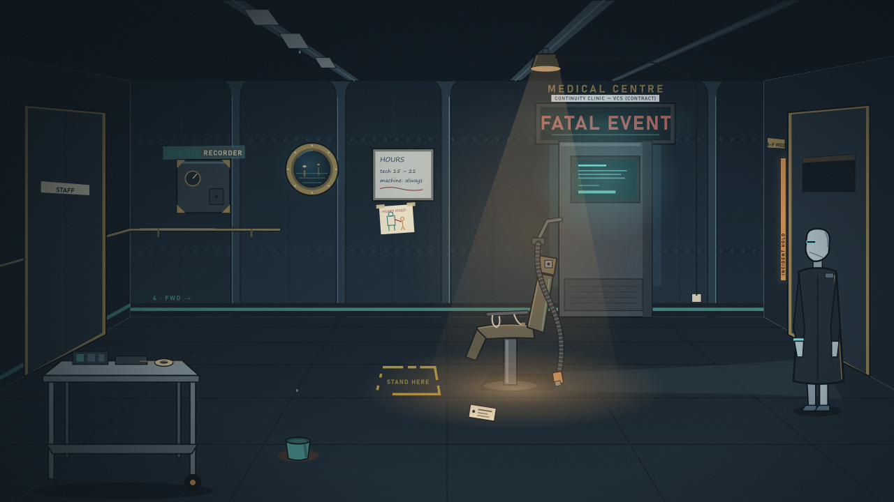

<p align="center">
  
</p>

<p align="center">
  
  
  
  
</p>

> **Two androids confess to the same murder. Their recordings are genuine. Their accounts cannot both be right. Then the man they say they killed walks through the door.**

**Borrowed Alibi** is a browser game about judging testimony. You play **Echo**, a municipal android built to reconstruct what witnesses saw. Your job has always been to help other people establish what happened. This case asks what *your* judgment is worth.

It takes place aboard **the Meridian**, a retired passenger liner turned into a neighbourhood. The old cabins are homes now, the promenade is a night market, and the service decks keep everything running.

<p align="center">
  
  <br>
  <sub><i>Style test of the opening room. A still image, not yet in the game.</i></sub>
</p>

## What you do

- **Walk the scene.** Inspect what's physically there, in any order.
- **Hear the account.** Question the people involved, who each want something.
- **Borrow a perspective.** Lay a recorded memory over the real room and compare them. A genuine recording can still be misread.
- **Decide what goes on record.** Your report changes how people treat you, and what the ship remembers.

The journal keeps what you *saw*, what you were *told*, and what you *concluded* separate, so the deductions are yours to make. Optional hints are there if you get stuck.

## The case file

<p align="center">
  
</p>

The game grows one chapter at a time, released weekly from October 2026 to January 2027. Each new file opens as its chapter ships. Choices you make carry forward into later chapters. Sealed files stay sealed: this repository doesn't contain story spoilers.

## Current build

**Prep Week 3: walking prototype.** Echo can walk around a placeholder version of the clinic, with furniture collision and depth sorting. This week adds the full first investigation: three clues, a witness conversation, the recorded-perspective comparison, the journal, the report choice and saving. The painted art replaces the placeholder blocks after that.

| Control | Action | Status |
|---|---|---|
| <kbd>W</kbd> <kbd>A</kbd> <kbd>S</kbd> <kbd>D</kbd> / arrow keys | Move | Working |
| <kbd>E</kbd> / <kbd>Enter</kbd> | Inspect, talk | This week |
| Mouse click | Inspect, talk | This week |

## Run it locally

You need [Node.js](https://nodejs.org/) 20 or newer.

```bash
git clone https://github.com/HamdanEsmail/borrowed-alibi.git
cd borrowed-alibi
npm install
npm run dev
```

Then open the address it prints (usually `http://localhost:5173`). `npm run build` produces a static version in `dist/`.

## How it's made

| | |
|---|---|
| **Game** | [Phaser 3.90](https://phaser.io/) and plain JavaScript, bundled with [Vite](https://vite.dev/) |
| **Art** | Hand-authored SVG, rendered with [Inkscape](https://inkscape.org/). Sources live in [`art/`](art/) |
| **Layout** | Room positions live in data files ([`src/data/`](src/data/)), so the art and the code share one blueprint |


## Repository layout

```
src/
  main.js              game configuration
  scenes/              one file per game screen
  data/                room layouts and story data
art/
  style-test/          clinic style test (editable SVG)
  readme/              sources for the images in this README
.github/readme/        exported README images
```

## License

The **code** is under the [MIT License](LICENSE). The **story, characters and art** are all rights reserved. See [`LICENSE`](LICENSE) for details.

---

<sub>Made by Hamdan Esmail for <a href="https://hackclub.com/">Hack Club</a> Terra. All characters, places and institutions are fictional.</sub>
